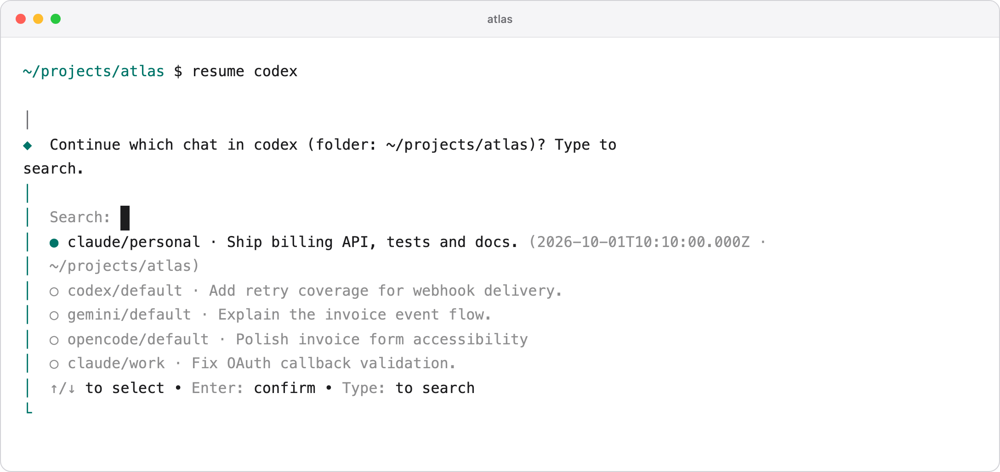
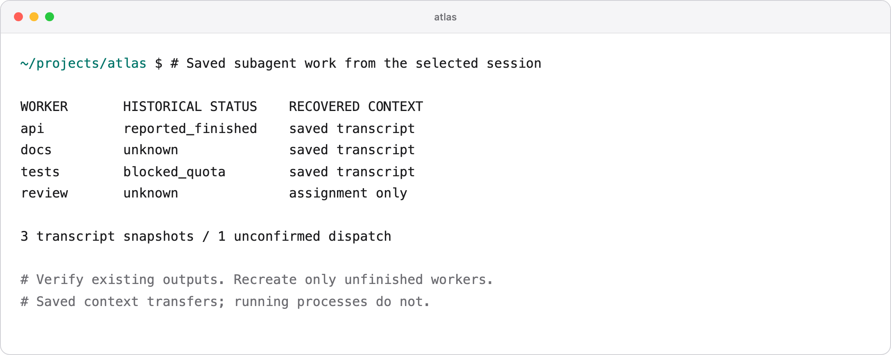

# resume-session

**Hit a usage limit? Continue your session with a different account or a different agent.**

Works with **Claude Code, Codex, Gemini CLI and OpenCode**. Pick a saved session, carry over its context, and recover unfinished subagent work.



## Install

```sh
npm install -g @pranciskusj/resume-session
```

Node.js **22.17+**. macOS, Linux and Windows. Your destination agent must be installed and logged in.

## Continue a session

```sh
cd ~/projects/atlas

# Choose the destination, then select a saved session
resume claude
resume codex
resume gemini
resume opencode
```

The picker shows this folder and its subfolders. It includes saved chats from previous logins and configured history folders. To use another account, log in through your agent first—resume does not manage credentials.

```sh
resume list                        # List this project's sessions
resume codex --search billing       # Search within this project
resume codex --path ~/projects/api  # Choose another folder
resume claude --all                 # Show every folder explicitly
```

## Share work with another computer

Available in the current source checkout. [Configure your cloud connection](https://github.com/pranciskus/resume-session/blob/main/docs/cloud.md).

```sh
# Select a session from the current folder and share a checkpoint
resume share

# On another computer, inside a checkout of the same project
resume rs_ID codex
resume rs_ID gemini
resume rs_ID my-claude

# Omit the agent to choose from those available on this computer
resume rs_ID
```

Works for research, writing, analysis, planning, and development. Git sessions restore file changes in a separate worktree. Google Drive sessions match the shared folder by ID and retain its existing permissions. If the workspace is unavailable, continue with session history only. Both computers use the same authenticated server. [Setup, access model and transfer limits](https://github.com/pranciskus/resume-session/blob/main/docs/cloud.md).

```sh
# Continue without the original repository or Drive folder
resume rs_ID codex --history-only
```

If context does not match, resume shows the required repository or Drive folder, explains how to get access, and offers history-only continuation. Ordinary folders can share history now; automatic file collection comes later.

## Bring your subagents

Saved assignments, transcripts and task relationships are recovered from **all four platforms**, so the destination can recreate unfinished workers or continue sequentially.

```sh
# Use an ID from resume list
resume codex --session SESSION_ID

# Inspect the handoff without launching an agent
resume codex --session SESSION_ID --prepare

# Preview launch arguments without writing files
resume codex --session SESSION_ID --dry-run
```



Same-agent, same-store sessions use native resume. Other selections start a new chat with saved context. Missing records are flagged; running processes, credentials and in-memory state do not transfer. [Recovery formats and limits](https://github.com/pranciskus/resume-session/blob/main/docs/recovery.md).

## Keep your aliases

```sh
# Save in ~/.zshrc or ~/.bashrc
alias my-ai='claude --model sonnet'

# Original alias options are preserved; extra flags pass through
resume my-ai --verbose
```

Alias names are detected from your shell configuration. [Shell and account setup](https://github.com/pranciskus/resume-session/blob/main/docs/usage.md#accounts-and-aliases).

## More

[Examples](https://github.com/pranciskus/resume-session/blob/main/docs/examples.md) · [Reference](https://github.com/pranciskus/resume-session/blob/main/docs/usage.md) · [Releases](https://github.com/pranciskus/resume-session/releases) · [Contributing](https://github.com/pranciskus/resume-session/blob/main/CONTRIBUTING.md)

Handoffs are saved locally in `.resume/`. Add it to `.gitignore`; it contains conversation text that the destination agent will read through its normal provider connection.

Tested on Node 22/24 across macOS, Linux and Windows, including recovery packets in all twelve cross-agent directions. [CI](https://github.com/pranciskus/resume-session/actions). Built on [continues](https://github.com/yigitkonur/cli-continues). [MIT](https://github.com/pranciskus/resume-session/blob/main/LICENSE).
