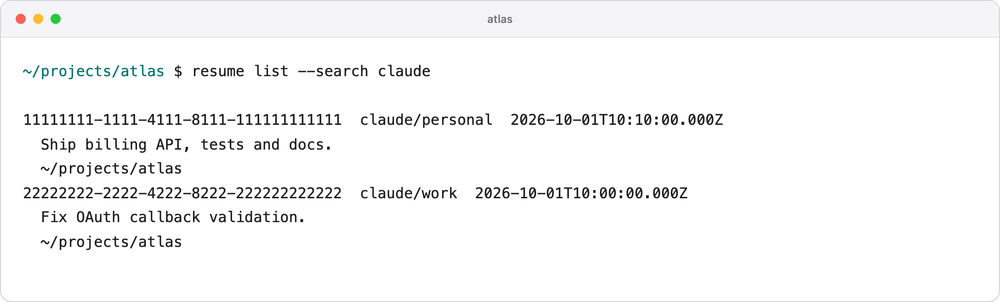
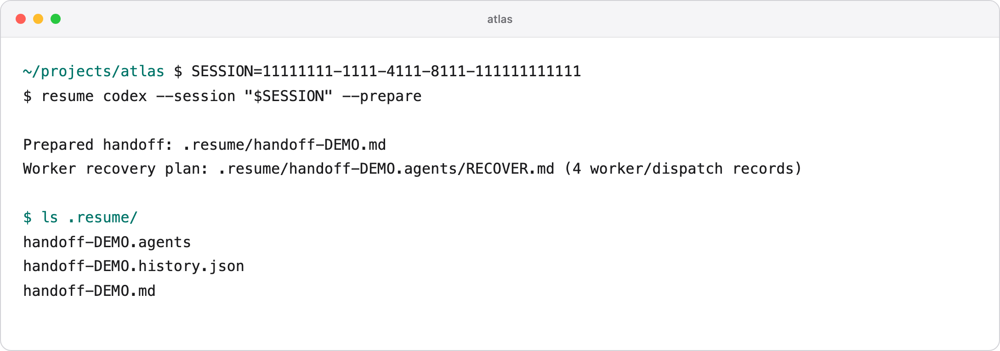
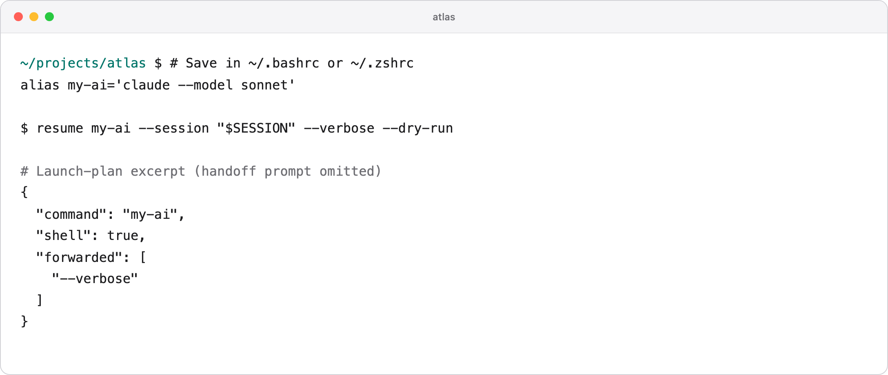

# Worked examples

These examples use fictional project names and placeholder session IDs. Run `resume list --json` inside your project to find your IDs; do not paste the demo UUIDs as if they were your own.

## Continue after changing your Claude login

Both logins used the default `~/.claude` history folder:

```sh
cd ~/projects/atlas
# Complete Claude's normal login flow with your desired account first.
resume claude
```

Choose the previous chat. With the same history root, this launches Claude's native `--resume SESSION_ID` using the active login. It does not restore credentials from the old chat. Saved subagent history may remain available, but this does not guarantee that old processes restart.

If each login used a custom root, register those roots first:

```sh
resume source add previous --tool claude --root ~/agent-profiles/previous-claude
resume source add current --tool claude --root ~/agent-profiles/current-claude
resume claude
```

Selection includes both roots. A chat from a different root uses a new handoff, keeping the target's active account environment.



## Move from Claude to Codex after an interruption

```sh
cd ~/projects/atlas
resume codex
```

Select the Claude chat. Codex gets a brief, a parsed conversation archive, and—when available—a Claude worker recovery inventory. It is instructed to reconcile existing files and current requirements before continuing.

For review without execution, substitute an ID from `resume list --json`:

```sh
resume codex --session SESSION_ID --prepare
```

The generated files have unique names:

```text
.resume/
  handoff-<unique-id>.md
  handoff-<unique-id>.history.json
  handoff-<unique-id>.agents/
    RECOVER.md
    manifest.json
    agent-<hash>.md
    agent-<hash>.jsonl
```

The `.agents/` directory appears when delegated work from any supported source is found. A missing transcript produces a warning and, when possible, an assignment-only record. Preparation never replays old tool calls or edits the task's output files.



## Use your own alias and preserve its options

Save this in your shell startup file:

```sh
alias clauded='claude --model sonnet'
```

Then:

```sh
resume clauded --verbose
resume clauded --session SESSION_ID --dry-run
```

Resume invokes `clauded` through the shell, retaining `--model sonnet` and forwarding `--verbose`. Alias targets use portable handoffs because the alias can change its history environment. For a native same-store Claude resume, use `resume claude` instead.

Options owned by resume are consumed by resume. Put conflicting target options after `--`:

```sh
resume clauded -- --help
```

Aliases created only in the current terminal are not inherited. See the [shell support reference](usage.md#accounts-and-aliases) for Bash, zsh, fish and PowerShell.



## Keep selection scoped to a project

```sh
cd ~/projects/atlas
resume list                         # Atlas and its descendants
resume codex --search webhook       # search those chats only
resume codex --path ~/projects/api  # choose a different folder
resume codex --all                  # all folders, intentionally
```

`~/projects/atlas-old` is not part of `~/projects/atlas`. A session ID is still subject to this folder filter. If the same ID appears in multiple stores, use its full `key` from `resume list --json` as the value of `--session`.

## Resume a project that moved

```sh
resume codex --path ~/old-location/atlas --cwd ~/projects/atlas
```

`--path` selects histories by their recorded directory; `--cwd` chooses where the agent starts. The new directory must already exist.

## Use Gemini or OpenCode as the destination

```sh
cd ~/projects/atlas
resume gemini
resume opencode
```

Select a chat from any supported source. Same-agent, same-root sessions use native resume where supported; other selections start a new chat with context. The target CLI must already be installed, logged in, and support the required launch flags.

## Recover workers from any supported source

The destination command works the same way regardless of the source platform:

```sh
resume claude --session CODEX_SESSION_ID
resume codex --session GEMINI_SESSION_ID
resume gemini --session OPENCODE_SESSION_ID
resume opencode --session CLAUDE_SESSION_ID
```

Replace these placeholders with IDs from `resume list --json`. Worker recovery runs automatically during a handoff. Use `--prepare` to inspect it without launching. If source and destination use the same agent and history root, native resume is preserved; add `--handoff` to explicitly generate a recovery bundle.

Claude workers, Codex child threads, Gemini subagent chats and OpenCode child sessions become the same recovery-packet format. The destination recreates unfinished workers using its own capabilities; original running processes do not transfer. See [format support](recovery.md).
